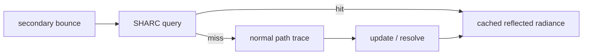

# Radiance Cache 与 Realtime Debug

> 类型：设计文档。本文只承载 SHARC world-space cache 和相关观测边界；RT 主积分契约见 [realtime-raytracing-sampling.md](realtime-raytracing-sampling.md)。

## SHARC 定位

SHARC 是 realtime Renderer-owned 的世界空间 radiance cache。它保存可供后续 bounce 查询的反射 radiance，不是 CPU scene、RenderWorld scene root 或 DLSS history 的替代品。

缓存的 world-space 粒度由 scene scale 和 level policy 决定；position bias 只用于稳定 hash cell 边界，不能作为 ray surface offset。

## 模式

- `Off`：不维护、不查询，画面不应依赖 cache。
- `Update`：执行 update/resolve 维护，但不查询；用于观察 cache 是否能稳定生成。
- `On`：维护并允许非 primary bounce 查询，命中后提前结束该 bounce 的普通追踪。

模式属于 realtime subsystem state，不进入 `DlssOptions`、`DlssSrState` 或 Runtime frame extent。

## 生命周期

SHARC targets 由 Renderer-owned subsystem 持有，属于世界空间持久资源，不按 render extent 或 FIF label 轮转。创建资源时初始化历史；subsystem 根据已提交的采样配置签名决定后续清空。

当 cache 参数或资源尺寸变化时，必须由 subsystem 决定清理或拒绝旧历史。Runtime 只提供通用资源、phase 和 shutdown Ctx。

当前签名只包含有限正数 scene scale、sky sampling mode、emissive NEE 和 analytic NEE。
这些配置变化时，在 Update 前清零三个 live cache。签名只随 queue submit 正常返回确认，
丢弃建图不能消耗 reset；这不是 GPU 完成或未知提交失败恢复凭据。

transform、材质、物体增删、灯光和天空数值变化不再全量清空，允许历史逐渐收敛。这会保留
暂态偏差；stale aging 只淘汰未更新条目，不等于场景语义变化时立即失效。强突变下的收敛与
残影需实测，不能把减少 reset 描述为无偏性或画质改进。

已提交的 Off / 无 TLAS 帧清除签名，重新启用时冷启动；Update 与 On 共享维护语义，
互切不清空。首次初始化和资源重新创建仍冷启动；相机、FIF、resize、DLSS reset、debug
和 SDR 配置不进入世界空间签名。Snapshot 容量及维护成本保持不变。

三个 cache buffer 和两个 Resolve 快照 buffer 在首次 clear 前完成组合分配。正常销毁在 GPU safe point 先释放 RT pass 的引用，
再逐个释放 buffer；resize 保留这些世界空间资源。快照不用初始清零，每次维护完整覆盖。

cache 单实例跨帧共享，帧提交顺序和内部原子操作不能替代访问依赖。RT pass 在首个
SHARC 访问前承接初始化 fill 的 TRANSFER_WRITE 以及此前 RT 读写，再串联
Update→Snapshot→Resolve→Query 的 RT 读写；入口依赖保守保留，Off 不消费缓存内容。
目前复用同 queue 的 global memory barrier，不引入 buffer RenderGraph 或跨队列 owner。

语义 reset 在同一次 RT pass 的 command buffer 中录制 fill：先以 RT read/write 与 CLEAR
transfer-write 为源、CLEAR transfer-write 为目的等待旧访问，再用入口依赖将 fill 发布给
Update。两个快照仍由后续 Snapshot 全量覆盖，不需要额外清理或 CPU queue wait。

## 数据边界

cache query 前已经考虑本地 emission；cache 中只存反射 radiance，避免同一 emission 重复累加。throughput 与 AO 语义不写入 cache 作为隐式衰减。

Update 对当前顶点以 throughput=1 计算直接光，再把后续散射权重乘入已登记顶点的传播
权重；本地 emission 与 sky 只向此前顶点传播。缓存复用可替代当前反射 radiance 并停止
续路，不再同时追加当前 NEE。插入失败必须保留无效索引，不能把未缓存顶点映射到槽 0；
该顶点的贡献仍可传播到路径中此前已登记的有效顶点。

当前固定 RTXGI v2.7.0 / SHARC v1.6.5.0，父/子 commit 分别为
`19b9be9e58ce2bbb6470b9444fa87e93a2dc4c4e` /
`0b9f58bbc8c41736042d4da964830a247e424a00`。接入遵循其 Integration.md 的逐段
throughput 与 Update/Resolve 顺序，但修改了插入失败输出，并在缓存外单独传播 emission。
anti-firefly、固定点累积与 fp16 历史仍是近似，不能把上游来源视为任意 HDR 范围的正确性证明。

Resolve 跨槽读取历史时必须使用同一稳定版本。Update 后的独立 Snapshot dispatch 完整复制
hash 与 resolved（包括空槽）；Resolve 的本槽和重复 key 查找都只读快照，
每个 invocation 只修改自己的 live hash/accumulation/resolved 槽。阶段间 RT 读写 barrier
隔开复制与合并，避免历史读取与其它 invocation 的淘汰竞争。

当前接入不提供前帧相机位置，不执行相邻 level 重投影；不可达分支已删除，未改变其它历史读取。

当前容量 2^22，快照增加 32+64 MiB 显存，每次维护全量读写 96 MiB 数据并多一次
TraceRays dispatch；Off 不产生该工作。保留碰撞历史继承，不依赖 invocation 顺序。
性能尚未测量，后续优化须保持稳定来源，不能仅移除快照或删除历史继承逻辑。

hash capacity 为零时 Insert/Find fail-closed 返回无效索引；生产实例固定为 2^22。
当前 key 的 position payload 是 17 bit、level 是 10 bit；accumulation 使用 u32 原子加，
resolved 使用 fp16 radiance/sample count。整数回绕、fp16 饱和、超出坐标编码范围及
非有限输入仍是明确支持域限制，不能从 shader 编译通过推断为已解决。

cache 不参与 ReSTIR reservoir history，也不改变 GBuffer、DLSS motion vector、present target 或 RenderGraph 的资源 owner。

## Debug 语义

debug channel 必须说明它观测的是哪一个阶段：surface event、普通 NEE、ReSTIR reservoir、cache update、cache query 或最终输出。

旧 magic number、未声明的 shader 输出和“看起来像 accum”的值不能作为长期 UI 契约。新增 debug 通道时，先定义数据来源、颜色/数值范围、是否跨帧以及是否受 reset 影响。

普通 RT debug channel 由 realtime subsystem 持有；Hello Triangle、ShaderToy 不显示 path tracing 专属 controls。

Hash grid 通道只对 primary hit 的 position/几何法线计算颜色，Off 也可观察；cache
radiance 通道只在 Update/On 读取本帧 Resolve 后的反射 radiance，Off 不读冻结历史。
两个通道在 primary miss 时输出零，不能显示 sky 冒充缓存。Query depth 记录正常路径
首次命中缓存的终止深度，不增加查询：黑=未命中、绿=1、黄=2、红=3+。

以上是 single-frame-rt 的原始输出语义。显示阶段 cache radiance 使用 radiance 变换，
hash/depth 使用数据通道；只有 Final 更新测光。启用 DLSS 时仍会重建这些输出，debug
选择本身不 reset DLSS，最终图像可能含时域影响；不能据此保证逐像素黑色或未滤波颜色。

primary 提前退出仍必须刷新本帧下游输入。surface-only 与 SHARC debug 不生成 ReSTIR
新候选时，写入当前 surface key 和空 initial；miss 则写空 key 和空 initial，不能留下旧 FIF 内容。
空 initial 表示没有新候选池，不等于强制清除合法 temporal history；后者仍经过 reset、
版本、几何和年龄检查。切回正常输出时重新生成当前 initial，不为 debug selection 单独增加 reset。

ReSTIR final phase 只为正常输出和 final contribution 通道重建、检查可见性并着色。
initial weight / temporal valid 通道只读对应 reservoir；其它 debug 保留 path 输出，
不执行无人消费的最终着色。这不省略 temporal/spatial phase，也不改变历史写入。

## 与 Runtime 的边界

Runtime 负责 frame timing、GPU resource registry、FIF 和 RenderGraph context；Renderer subsystem 负责 SHARC buffer、算法状态、mode 和 debug selection。

Runtime shutdown 前，Renderer 必须先释放 SHARC pipeline、buffer 和 descriptor。RenderGraph 只导入当前 pass 需要的 cache view，不延长 cache owner 生命周期。

## 设计不变量

- SHARC 是优化/近似缓存，不是 scene authority。
- cache hit 不改变 primary output 和 DLSS input 语义。
- cache mode 和 cache history 不混入 Runtime 配置或 DLSS history。
- debug 输出必须有稳定观测语义，不能复用无定义的旧通道。
- cache 资源遵守 Renderer-owned 创建、resize（如有）和 shutdown 顺序。

## 实现入口

- [`renderer_rendering/realtime`](../../renderer/renderer-rendering/src/realtime/mod.rs)
- [`realtime shader`](../../renderer/shader/lib/renderer/realtime_rt/)
- [`render configuration`](render-configuration-and-temporal-state.md)
- [`resource lifecycle`](resource-lifecycle-and-destruction.md)

## Cache 失效

cache 的 scene scale、资源拓扑、单位约定和 shader ABI 必须保持一致。发生完整场景重载、单位切换或 cache layout 变化时，旧 history 只能在有明确失效证据时复用。

查询命中必须经过当前材质、法线、距离或其他 guard；cache 不能因为命中就绕过当前 frame 的必要可见性约束。

当前 Query 只用于 On 的非 primary、当前及上一段均非 delta 的命中；段长和 glossy cone
必须覆盖 voxel 尺寸。命中要求 resolved sample count > 0，返回反射 radiance 乘以当前
throughput，随后终止该路径，不能再叠加本顶点 NEE；本地 emission 已在查询前单独计入。
这些守卫沿用固定版本 Integration.md 的空间近似，不证明 view-dependent glossy、法线
分桶或有限路径深度下无偏，也不是任意非有限数值的完整支持域。

## Debug 变更

增加 debug mode 时同时定义：数据写入阶段、数值范围、颜色映射、是否受 temporal reset 影响，以及关闭该 mode 是否改变主路径。

如果 debug 资源只服务观察，不应进入长期 public ABI；如果 shader、Rust 和 UI 共享该通道，必须把 enum、binding 和 owner 一起更新。

## 变更检查

- cache 是否仍由 Renderer subsystem 拥有？
- cache buffer 是否错误地按 FIF 或 render extent 分配？
- update、resolve、query 的顺序是否清楚？
- 命中是否改变 primary、DLSS 或 ReSTIR 语义？
- debug channel 是否与普通 NEE 观测混淆？

## 非目标

本文不定义 cache 命中率、画质指标或 GPU 性能阈值；这些需要单独的运行时实验和图像验证。

## 证据边界

shader 编译和 graph 录制只能证明 cache 路径可生成命令；命中稳定性、噪声和性能仍需要实际 GPU 场景验证，不能从静态文档推断。

SHARC 的 cache query、update 和 resolve 仍属于同一个 Renderer subsystem 的状态机；它们不能被不同 subsystem 各自实现一半。

未来若扩展运行时 scene reload，须保证当前签名仍唯一标识场景语义，或显式切断 owner
历史；不能依赖资源 Drop 的偶然顺序，也不能让新场景复用相同版本却沿用旧缓存。
