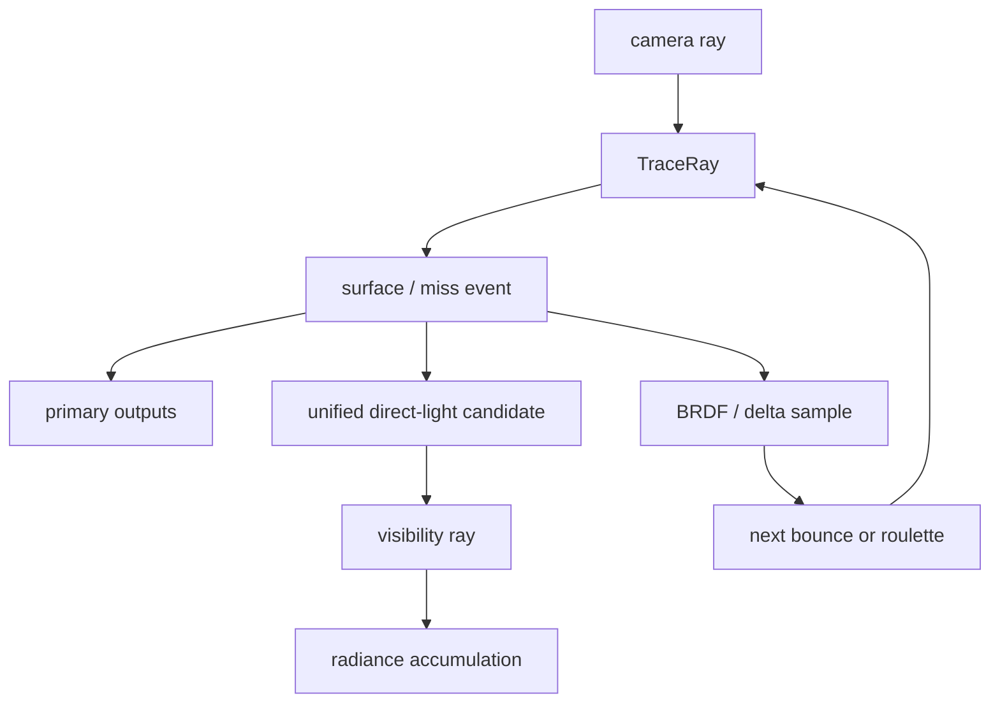

# Realtime Ray Tracing Sampling

> 类型：设计文档。本文记录 realtime RT 的积分、直接光候选和历史复用边界；具体 shader 字段以 ABI 为准。

## 责任边界

raygen 推进 path state 和 bounce 顺序；closest-hit/miss 只整理命中事件。材质求值、直接光、MIS、debug 输出和最终写入由 raygen helper 组合。



Realtime 和 Offline 共享 surface/material 语义，但各自拥有 pass-local mode 和 temporal state。
共同事件/trace 类型仅定义于 Renderer ray_payload，不能在两套入口复制；descriptor、push
constants 与深度策略继续由各 pass 入口持有。

## Bounce 顺序

一次 trace 返回一个事件。raygen 的语义顺序是：

1. miss sky 时累加环境 radiance 并结束路径；
2. 第一次 hit/miss 写 GBuffer、motion vector 和 DLSS 输入；
3. 累加本地 emission；
4. 对非 delta surface 生成直接光候选；
5. 采样 BRDF 或 transmission，更新 throughput 与 PDF；
6. 在满足条件时执行 Russian roulette；
7. 继续下一 bounce 或输出累计 radiance。

primary 输出只写一次，后续 bounce 不能覆盖 camera primary 的深度、normal 或 motion vector。

## 统一 Light Candidate

HDRI、emissive triangle 和 analytic light 进入同一候选抽样入口。candidate 至少表达方向、距离、radiance、solid-angle PDF 和 shadow ray。

class 选择概率必须乘入对外 PDF，使 `P(class) * P(sample | class)` 与 BRDF PDF 处于相同 solid-angle 度量。visibility 只判断遮挡，不执行普通 closest-hit shading；alpha mask 仍使用与材质路径一致的 alpha test。

候选 shade 统一遵循：

```text
path_throughput * light_radiance * BRDF_cos / light_pdf * MIS
```

普通 NEE 和 BSDF 续路对有限正 proposal PDF 直接相除，不能用固定分母 floor 改变
低概率方向的贡献；零、负或非有限 PDF 返回空贡献/终止样本。MIS 仍使用同一完整密度。
这不保证任意 HDR、subnormal 或中间乘积都可表示。ReSTIR initial 使用同一实际 PDF，
不设 inverse-PDF 或归一化分母的固定 floor；raw 权重的范围处理见下文。

硬深度上限仍限制实际 trace 次数（主路径 16、SHARC Update 8）。每个已命中的末顶点
保留 emission 与 NEE；因为不会生成下一次 BSDF trace，末顶点 NEE 使用权重 1，随后停止，
不再采样材质或 roulette。此前顶点的 BSDF-hit/miss emission MIS 不变。
这定义了末顶点仅由 NEE 估计直接光的有限深度策略，不补齐 delta-only 末顶点的额外 trace。
随机 roulette 有存活补偿，不能把某次随机终止当作硬上限来切换 NEE 权重。
SHARC cache resampling 命中时仍以缓存 radiance 替换当前 directLighting；其近似另行评估。

analytic light 当前使用固定 `MIS = 1`，因为它没有完整的 BRDF-hit 竞争估计器。

Point/spot 的 RT 表示是固定半径 0.005 m 的球面 emitter，color 为 radiance；不再额外乘
点光式 inverse-square，几何衰减由其可见立体角产生。球外采样与 key 重建共用锥参数
`sin_max=r/d`、`1-cos_max=sin_max²/(1+sqrt(1-sin_max²))`，不以固定 sr 下限截掉远处小球。
采样直接构造球面法线并存入 key，再用相对中心向量连接；重建要求该法线朝向当前视点，
不能用随距离放大的 nearest-hit 容差接受背面。球内/过近的既有拒绝域不变。
参考 PBRT `b4ce9687e6c695f5582997c61b0c66cf064bdb4a` `shapes.h::Sphere::Sample/PDF`：
沿可见锥均匀采样并直接构造球面点；本项目使用有理化锥高代替小角度 Taylor 分支，
保持原有 Y-up/世界坐标基、单位方向和无 TLAS analytic emitter 的限制。
float 方向在远距离窄锥内仍有量化误差；同一视点的 key 往返不证明 ReSTIR 跨视点 Jacobian 正确。

Spot 的发射方向衰减由同一 RtDirectLighting 函数服务新采样和 key 重建，只乘 radiance，
不修改球面 proposal PDF；锥外样本作为零贡献拒绝，不重抽样或重新归一化。CPU 校验
`0 <= inner <= outer <= f32 π` 并准备方向。内锥为 1，外锥之外为 0，等角时采用包含边界
的硬锥；非零过渡保留 `clamp((cos(theta)-cos(outer))/(cos(inner)-cos(outer)),0,1)`。
不能用固定余弦分母 floor 压低窄锥亮度，也不在 shader 静默交换非法内外角。

当前直接计算余弦差与正宽度；内外角相等，或两个余弦舍入为同值时使用硬锥，禁止零分母。
参考上述 PBRT commit 的 `lights.cpp::SpotLight::I`、`util/math.h::SmoothStep` 的分区与
等角边界；保留本项目余弦线性衰减和球面 radiance，不移植 PBRT 的 SmoothStep 曲线或
delta-position intensity。极窄锥可能量化为硬边，GPU intrinsic 精度仍需画面验收。

area candidate 与 geometric normal 的 max-rescale 保护仍保留；没有更窄输入域时不能删除
其溢出/下溢防护。介质侧继续由几何法线决定，观察/采样方向有效域、玻璃 eta 和 GGX 无效
采样拒绝保持现状；本轮不引入基于插值法线的 front_face 或法线弯曲模型。

Mis::power_heuristic 接受同一度量下有限、非负的完整 PDF（含 class 选择概率），计算一次
light 与一次 BSDF 采样的平方比值。先除以两者最大值再平方，消去公共尺度，避免固定分母
epsilon 破坏互补权重或大 PDF 平方溢出；(0,0) 定义为零贡献，不为不存在的策略分配权重。
参考 PBRT `b4ce9687e6c695f5582997c61b0c66cf064bdb4a` 的
`src/pbrt/util/sampling.h::PowerHeuristic`，本项目用公共尺度归一化代替其单侧溢出分支。
该数值改动不替代 PDF 生产端的合法性、candidate 分母、ReSTIR 归一化或 GPU FTZ 验证。


## 材质与坐标

OpenPBR 是后续材质模型演进的基准，版本由根目录 `resources.toml` 中的 `openpbr-repo` 决定。
当前实现尚未完整符合该模型；已实现子集和偏差必须与目标语义区分，不能仅凭参数同名直接映射。
Realtime、Offline、NEE、ReSTIR 和 SHARC 应消费共同的材质语义与求值契约，
采样或缓存优化不能隐式改变材质模型，也不能在消费者中另建一套材质公式。

MaterialAccess 统一 UV 集、纹理变换、sampler、色彩空间和 fallback。base color、metallic/roughness、normal、emissive 的 factor 与 texture 只组合一次。
CPU 材质入口拒绝越界 metallic/roughness、base alpha 和负 RGB；RGB 保留既有 HDR 表达范围。
MR 贴图可能来自 HDR，MaterialAccess 将 factor 与通道乘积限制在 [0,1]，再用于分类、采样概率和
GGX alpha。限制属于材质通道语义，不修改共享纹理或发光/天空数据；参数合法不等于能量守恒。

trace 命中的 origin_normal 来自 object-space 三角形绕序，经 inverse transpose 变换到世界空间；
负 determinant 不额外翻转，以保持既有 object-space 内外侧约定。介质判面、ray offset 和 SHARC
使用此几何法线；object_normal 仍保留插值顶点法线供诊断。当前 forward_normal 的判面仍使用
插值法线，normal map 后不保证朝向观察方向；BRDF/GBuffer/RR 共用同一着色结果。
BSDF 的观察方向必须在实际着色正半球，普通反射的出射方向也须在正半球；sample/eval/pdf
统一拒绝无效方向。被拒绝的样本为终止的零贡献，不重采样或归一化剩余概率。delta 没有连续
BRDF 值或密度；光滑界面显式报告无效观察输入，RR 同步归零。IOR=1 没有界面，仍直接透射。
这只是现有着色模型的有效域，不保证反射/透射位于正确几何侧，也没有补偿法线扰动后的能量。
ReSTIR surface key 分开保存着色法线和几何法线，current/history 共用解包检查。
几何法线保留 traced hit 的单位 float 分量，用于重连 visibility 的 offset；不能从着色法线、
normal map 或压缩 GBuffer 猜测。空 key 清空所有通道，非法输入在归一化前被拒绝。

法线映射复用 MaterialAccess 的世界空间 TBN：normal 用 inverse transpose、tangent 用 model，
handedness 乘 model determinant 的符号。authored tangent 使用原方向；缺失时按已变换 UV 的
差分重建。因此 UV 旋转/镜像可能使两条路径不同。OpenPBR v1.1.1 的 Normal maps 章节要求
单位向量与明确映射 metadata，却不规定唯一切线纹理参数化；不能据此宣称两条路径都符合
同一种烘焙约定。统一切线生成/变换、双面与几何侧约束、shading-normal 能量处理需要一起设计，
并同步 ReSTIR 几何输入和 RR guide；当前只记录提案，不以翻转或截断法线代替完整模型。

surface origin offset、shadow ray TMax、RT TMin/TMax 和 SHARC position bias 是不同语义，不能用同一个 epsilon 替代。世界量纲和 PDF 度量必须保持一致。

throughput 只传播 BSDF 等实际积分权重，不把 AO 或 debug 值混入 path state。emissive hit 与 emissive NEE 使用相同 light PDF 语义，避免 MIS 概率不闭合。

### 当前反射模型与 NDF 采样

普通 Surface 当前使用 Lambert 加单次散射 GGX，dielectric F0 固定为默认 IOR=1.5 对应的 0.04，再按 metallic
与 base color 插值；diffuse 尚未按 Fresnel 分配能量。这是现有模型偏差，不是 OpenPBR 的目标
能量约定。Surface 的 CPU class 没有 IOR，ABI 中 ior=1 只是非 Transmission 的当前投影；
`RtMaterialSampler::surface_f0` 统一主路径、NEE/ReSTIR 和 RR 的 Surface 反射参数；不能直接用
ABI 的占位值计算反射率。自定义 Surface IOR 仍不支持，导入继续拒绝；未来开放此参数必须
一并修改 CPU/导入、ReSTIR surface key 和 RR，不能只替换一处公式。

`SpecularBrdf` 只承载共同 GGX 求值与采样。输入 normal/view/h 为单位向量，roughness 参数为
alpha；Renderer 把艺术粗糙度 r 平方后传入。r≤0.02 走独立 delta，合法非 delta 域为 (0.02,1]。
NDF 采样使用完整 [0,1) 随机数，H 的密度为 D*NdotH，反射方向 PDF 为 D*NdotH/(4*VdotH)。
不截断均匀数或条件重采样；反射到无效半球的样本贡献为零，而非擅自归一化剩余方向。
用正项相加求逆 CDF、分别计算 sin²/cos²、用 |N×H|² 求 D，以保留低粗糙度的小角度精度。
现有 D/pdf/throughput 的 epsilon 仍是数值保护，不意味着极限方向和任意 alpha 都严格无偏。

模型依据为 OpenPBR v1.1.1 `f8d6d947dfae4c9b599965a86c22826ea7a8dbfb` 的 Microfacet model/GGX；
叉积形式参考 Filament v1.77.1 `477aee3faa2d402545ebcbb65fb0cf6e1c9d0d0e`
`shaders/src/surface_brdf.fs::D_GGX`，保留项目 float32 求值而不复制其 fp16 截顶。
这里仍是 NDF 采样，不能套用 PBRT 可见法线采样的 VNDF PDF。

纯 EMISSIVE 类别在累加 emission 后终止，没有反射 BSDF；其连续反射值/PDF 与 RR 两份
albedo 都为零。Surface 携带 emissive factor 不改变其反射模型，不能仅凭发光颜色清除 guide。

RR 的 delta specular albedo 复用当前 primary ray 下的实际反射求值：理想镜面用同一 Schlick，
光滑透明界面用同一 IOR/Fresnel/TIR。透明面的反射 guide 不乘 metallic、base color、opacity
或透射 eta²；两种 delta 的 diffuse guide 都为零。rough surface 仍使用 F0 近似，尚未得到
观察方向相关的完整 GGX 积分；该反射 guide 也不表示 RR 已拥有完整透射/折射运动信息。

### 光滑介质界面

`RtDielectricInterface` 统一空气与当前材质之间的方向、完整非偏振 Fresnel 和全内反射求值，
由材质采样与 RR specular guide 共用；当前 motion 使用 primary instance 重投影，没有完整透明运动。
IOR=1 时直接透射，不计算掠射的 Fresnel 比值。
普通镜面材质的 F0 不参与玻璃计算；当前不支持嵌套介质栈。

界面用叉积获得切向分量，先乘 eta 再求 Snell 的平方，避免大 IOR 的 eta² 溢出与近法线
sin² 下溢；通过 TIR 判定后，再组合透射切向与法向。Fresnel 用 IOR≥1 缩放两偏振比值，
避免极小倒数的退化。输入方向/法线仍须单位化且朝向正确；这些改动不替代几何法线来源校验。
float32 的临界角舍入仍可能改变 TIR 分界，极大 IOR 下 Fresnel 误差可显著放大；有限结果不等于
完整精度保证，GPU 的 subnormal/FTZ 行为也须单独验收。

令 `η=n入射/n出射`、`R=F`、`T=(1-opacity)*(1-F)`、`S=R+T`。反射/透射以 `R/S`、`T/S`
选择，选中后的 throughput 分别为 `S` 和 `S*base_color*η²`；S=0 终止路径，全内反射的权重为 1。
opacity 只衰减透射，不把损失转成反射；opacity 与颜色都逐界面应用，闭合玻璃会衰减两次，
并非按厚度计算的体积吸收。rough transmission 仍未实现 BTDF，当前回退到普通反射表面。

这套玻璃 `opacity` 是当前项目的逐界面透射衰减参数，与 OpenPBR `geometry_opacity`
表示整个表面的存在权重不同，不能直接映射。对照依据为 OpenPBR v1.1.1
（commit `f8d6d947dfae4c9b599965a86c22826ea7a8dbfb`）的 `index.html` 中
“Opacity / Transparency”章节。后续迁移应统一处理材质参数、导入映射与 shader；
确立模型基准本身不改变上述现有行为，也不触发自动参数迁移。

eta² 是 radiance transport 尺度。RtMaterialSample 从同一个分支补偿后的 BSDF 权重生成
radiance 和 roulette 两份乘子，后者不含 eta²；RtPathState 分别累计，两者都保留吸收/颜色，
并在 roulette 存活时除以同一个概率。不再用微小 radiance 乘巨大 eta 倒数恢复存活权重。
该分离不改变实际 radiance，也不解决它自身的浮点溢出/下溢；一般 HDR 权重乘积仍有支持域限制。
Emission 只由 hit/miss 阶段累加，RtMaterialSample 只描述散射，不再保存 emission。
纯 EMISSIVE 的采样结果为终止、零散射/PDF，反射 hit-distance guide 直接使用项目既有
无命中值；普通 Surface/Transmission 带 emissive 时仍正常反射/透射并生成 guide。
三个路径循环在进入材质采样前已处理 emission 和纯发光终止，不依赖重复的采样 emission 通道。
RtPathState::apply_russian_roulette 仅返回是否继续；两份 throughput 的存活补偿在内部完成，
raygen 只决定是否发出下一跳，不能再次应用补偿系数。
delta 链和 depth<3 仍跳过 roulette；其余存活概率保持 max-channel clamp 到 [0.05,0.95]。
RNG 为 [0,1)，存活条件是 rnd<p，等于 p 终止；幸存路径按同一个 p 补偿。
delta 后的 sky miss 不套环境 MIS。SHARC 继续消费 radiance throughput，不消费 roulette 乘子。
语义对照为 PBRT `b4ce9687e6c695f5582997c61b0c66cf064bdb4a`
`cpu/integrators.cpp::PathIntegrator::Li` 的 beta/etaScale；本项目 eta 是其介质比的倒数，
存活阈值与跳过 delta 的策略也不同，未复制 PBRT 的整个 roulette 策略。

当前 r≤0.02 把整个 Surface 分类为纯 delta，非金属 diffuse 也随之消失；阈值两侧存在模型
不连续。正确的 lobe 组合不能只改分类或粗糙度下限：需同步离散/连续 sample、eval/PDF、NEE、
MIS、ReSTIR eligibility/key 与 RR guide，并结合前述层能量方案。rough Transmission 的
反射 fallback 忽略 IOR/opacity，也不是已实现 rough BTDF。这些统一模型迁移只记录方案。

## ReSTIR DI

ReSTIR DI 只服务 camera primary visible surface；secondary bounce 继续走普通统一 NEE。

initial 以 `target/pdf` 竞争，固定八次 proposal（包括零 target）参与归一化，finalized 输出
M=1。temporal/spatial 复用保留来源的原始有效 M（包括小于 1 的正值），累计 M、竞争
权重和校正分母不得分别抬高到 1；M=0 不参与复用。combine 以 `target_at_current * source_weight * source_M * J_current/J_source` 竞争；局部 raw sum 使用
普通 float，不保存尾数/指数。finalize 仍计算
`raw_sum * numerator / (selected_target * denominator)`；storage 图像格式不变。
target 与最终 RGB 复用同源 BRDF/MIS，不重复除 PDF。
RTXDI 参考为 v3.0.0 父仓库 `274141af082050c9d0ad6e01a2e591d0d66b7955`、
Rtxdi 子库 `a14e079c727ed8c4fd3173bd2aea8244c9d9f6d6`，
`DI/Reservoir.hlsli`；此处调整数值表示，不改变其加权竞争与归一化公式。

候选池存在与 winner 有效是两个状态：合格 surface 完成八次 proposal 后，即使全为零，
initial 仍输出 M=1；未采样、不合格或拒绝的来源才没有候选池。存储中的零估计池使用
正 M、零 weight/target、无 winner/key，版本仍须匹配。temporal/spatial 接受此类池并累加 M，
但不重建其候选；校正时仍在它的 source surface 上评估最终 winner，计入对应 target×M。
否则复用会条件化到“至少采到一个正贡献候选”，造成偏差。final shade 仍只接受有效 winner。
采样配置改变时必须拒绝整个历史池，包括没有 key 的零估计池；CPU 以实际提交帧的模式、
sky sampling mode 和 emissive/analytic NEE 开关判断连续性。有效 winner 的 class mask
还须在 shader 接受池之前匹配当前策略，不能只在重建失败后返回零 target 却继续累加旧 M。
光源集合/分布变化由 sky、emissive、analytic 版本拒绝，零估计池也携带并检查这三个版本。
有限零归一化结果保留 M 并清除 winner；非法统计不作为零估计接收。history cap 不把 M=0
抬高到 1；spatial 的 8/16 候选选择按候选池 M 判断，不按是否存在 winner 判断。
零估计没有可老化的 sample identity，输出 source_age=0；有效 winner 仍保留原年龄限制。
此处对照同版 RTXDI `DI/InitialSampling.hlsli` 的无条件 M=1、`TemporalResampling.hlsli`
的 previousM 与 `Reservoir.hlsli` 的独立 M 累加，不移植其整套采样策略。

输入有效性、正分母和 streaming 权重检查保持。中间权重、M、piSum 或累计权重非有限时，
立即将本次输出 reservoir 标记失败并停止后续合并；失败锁存只在 shader 局部存在，输出 M=0，
不能被下一候选恢复成有效估计。finalize 继续检查乘积、正分母和最终 inverse PDF。
超出普通 float 支持域时丢弃整个 reservoir，不夹紧权重；浮点舍入、下溢、24-bit RNG 与
GPU FTZ 仍限制极小概率。这个范围取舍会丢失极端 HDR/低 PDF 的贡献，不能宣称完整复用
无偏或任意 HDR 范围正确；必须结合无复用参考和多帧统计验收。

有限光源 key 保存 light-side 点，`J_x=light_cos_x/distance_x²=dω_x/dA`；emissive 使用
绝对光源余弦，单面矩形和可见球面使用正余弦，HDRI 方向 key 的 J 比为 1。距离与余弦
来自未偏移的几何连接，不使用 shadow ray 的偏移长度。有限大小的 point/spot sphere
也必须转换；不能把它们当作零面积 delta point light。
竞争把来源的立体角 inverse PDF 乘 J_current/J_source；校正将最终 winner 在各来源上的
target 乘 J_source/J_current，再形成分子与 piSum。两种比例均计算为普通 float 的余弦比
与距离比平方；方向和归一化公式保持，非有限中间值使本次 reservoir 失效。
这样 reservoir 存储仍是其输出 surface 的立体角 target/inverse PDF，initial 和 final shade
无需另乘 Jacobian，storage/ABI 不变。RTXDI FullSample 的 RAB 使用随机 UV 与条件 PDF
配套定义 target；本项目保留物理 light-side key，不能仅复制它除 solidAnglePdf 的一步。
此转换修复跨 surface 的度量，不消除 key 量化、GPU FTZ、历史 TLAS 和有限支持域的限制。

```text
path phase -> initial reservoir
-> temporal reuse -> spatial reuse
-> final visibility + current target
-> primary direct contribution
```

surface key、motion、depth、normal、roughness、base color 和 metallic 用于 history rejection。最终阶段在当前 surface 上重建 candidate 并重新 trace visibility，不复用历史 visibility。
通过 visibility 后，final shade 一次计算未加权 BRDF/MIS 贡献，同时判定当前 target 非零，
再乘 finalized inverse PDF；不另行调用 target 查询重复求值，也不再次除以 proposal PDF。

target 的观察方向属于 source surface 的定义：候选在当前像素竞争时用当前相机，
temporal 校正则用上一提交帧相机观察历史 surface；spatial 的双方都使用当前相机。
历史方向由已有 prev_view 的刚体旋转/平移恢复，不能隐式读取当前 camera_pos。
当前 Camera 产生刚体 view；若以后允许 view 缩放/shear，必须同步修改此恢复方式。
历史 visibility 暂时仍查询当前 TLAS，这一近似不能由观察方向修正消除。

temporal 先取第一个 surface-compatible 的搜索位置，再检查该处候选池；不按 winner
有无继续搜索。spatial 对固定 offset 集合的两轮遍历使用同一接受条件与 8/16 次数，
越界位置直接跳过。材质、法线、深度与位置阈值是限制复用范围的启发式，不是无偏证明。
当前深度比较未补偿相机平移；搜索可缓解失配，但不保证
找到对应样本。后续调整需连同提交帧历史、支持域和 GPU 画面验证，不能只放宽一个阈值。

历史数组重投影使用 `pixel + MV + current_jitter - previous_jitter` 再舍入；MV 保持无 jitter
的 previous-current 投影语义，jitter 使用像素坐标方向。previous jitter 随实际 ReSTIR
提交确认保存，不能由当前 DLSS 序列推算；这只修正搜索中心，不保证邻域兼容性或画质。

surface key A/B/C/D 使用 RGBA32F，依次保存 position/depth、着色法线/roughness、
base_color/metallic、几何法线/0；几何法线补齐的是 visibility 输入，不改变现有 rejection 阈值。
它们由 RestirDiTargets 按 FIF 持有，current/history 使用 RT pass 的独立普通 descriptor set，
每 FIF 一份，在 Runtime 等待槽位完成后更新全部 binding；resize/shutdown 仍在 GPU safe point。
temporal 与 surface 图像还会被后续一帧读作 history，覆盖前不能只依赖本槽旧提交的 FIF 等待。
current 导入保持 GENERAL，并声明先前 RT storage 读写，交现有 graph barrier 约束跨帧访问；
不能以 UNDEFINED_TOP 丢弃布局提前越过 history 读取。initial/final 仍只在本帧使用。
reservoir 继续用 push set，surface 不占全局 bindless slot。设备需容纳 global、RT、SHARC、
surface 共六个 set；RT 构造前检查该上限。每 FIF 新增 16 字节/像素的几何法线图像。

resize、mode、sky/emissive/analytic version 变化会阻止旧 reservoir 继续复用。ReSTIR debug channel 只表达 ReSTIR 结果，不反向污染普通 NEE debug channel。

temporal history 先推进 source_age，再统一执行 age<=8 的复用判断；过期来源不进入竞争、
M 或 piSum。禁止先按旧年龄接受、再只从 winner 竞争中排除，留下不对应任何 proposal 的分母。

## Debug 边界

surface-only debug 可以在当前事件后早退，减少不必要 path。`NeeHdri`、`NeeEmissive`、`NeeAnalytic` 描述普通 NEE 观测；ReSTIR final contribution 使用独立语义。

debug mode、sky brightness 和 NEE 开关是 pass-local 控制，不改变 Runtime-owned target 尺寸、DLSS feature 或 RenderWorld asset sync。

## 设计不变量

- primary 输出、直接光和后续 bounce 使用明确的生命周期顺序。
- 所有直接光 PDF 对外使用 solid angle 度量。
- candidate 的 light-side radiance 不包含 BRDF、cos、MIS 或 path throughput。
- ReSTIR 只替换 primary direct lighting，不改变 secondary NEE 契约。
- 共享材质求值不能在 RT、raster、raycast 路径各自维护一份规则。

## 实现入口

- [`raygen.slang`](../../renderer/shader/entry/renderer/realtime_rt/raygen.slang)
- [`raygen_direct_lighting.slangi`](../../renderer/shader/lib/renderer/realtime_rt/raygen_direct_lighting.slangi)
- [`restir_di.slangi`](../../renderer/shader/lib/renderer/realtime_rt/restir_di.slangi)
- [`surface_hit.slangi`](../../renderer/shader/lib/renderer/realtime_rt/surface_hit.slangi)

## Sky 与 emissive

HDRI importance distribution、uniform sphere fallback 和真实 sky image readiness 属于 sky resource owner；shader 采样和 PDF 查询必须读取同一 distribution 语义。

Sky builder 在源分辨率上对线性亮度使用横纵 `[1,6,1]/8` 核，U 环绕、V 钳制，
覆盖双线性 radiance 扩散到相邻 texel 的区域，再乘源 texel 立体角累加到目标 cell。
这是线性重建平均亮度构成的近似 proposal，不是双线性天空球面积分的精确解；
它只改变采样密度，不模糊 HDRI、不裁剪太阳，也不能为折射/反射焦散求解连接路径。
Alias 概率与 solid-angle PDF 必须从同一份过滤权重生成；有限正总权重均参与归一化，
全黑输入使用 uniform fallback。BRDF HDRI 包括所有 sky miss，NEE HDRI 包括所有 bounce 的环境 NEE。

EnvMap 在选中 cell 内按球面积均匀生成方向：极区以距最近极点的球冠面积
`q=1-cos(alpha)=2*sin²(alpha/2)` 插值，再由 `sqrt(q*(2-q))` 恢复水平半径；
中部直接插值 Y。方向查询以 `atan2(length(xz), y)` 求北极夹角，避免只从已舍入到 ±1
的 Y 恢复纬度。两侧共享 Y-up、`atan2(x,z)` 的经度约定，不改变 CPU 的 cell 立体角 PDF。
参考 PBRT `b4ce9687e6c695f5582997c61b0c66cf064bdb4a` 的
`util/sampling.h::SampleUniformSphere` / `util/vecmath.h::SphericalDirection`：沿球轴均匀抽样、
直接构造方向；本项目适配 lat-long cell，并以半角恒等式处理窄极区的消减误差。

上述连续概率模型不等于任意 float 输入下的精确一致：行列边界、接缝和随机端点仍可能
舍入到相邻 cell，重新查询 PDF 不能恢复被舍入前的抽样分布。24-bit RNG 的 column 分桶、
连续随机槽相关性，以及极端 HDR 比值使 f32 PDF/alias 阈值下溢的支持域仍待联合评估；
不能用任意 epsilon 或单个零 cell 的 uniform fallback 掩盖这些偏差。

emissive triangle table 由 RenderWorld 在 prepare 产出 active render data 后构建。alias table 只包含有效面积和正 power record；材质变化、mesh readiness、instance transform 或绑定变化必须使 table 重新准备。

CPU 元数据与 world light table 共用 RtTriangleMeta 的 f64 面积向量计算；先扩展顶点再相减，
局部面积也以 f64 保留，避免小局部三角形在 instance 放大前被误判退化。GPU 面积仍为 f32：
下溢为零或超过其范围的世界面积保留原 primitive 记录、零 select_pdf，不进入 alias。
这不恢复 f32 顶点/世界变换已丢失的精度，也不保证这些尺度可由 BLAS 或 shader 正确追踪。

emissive hit 的 light PDF 通过 instance、geometry、primitive identity 反查 table；它与 NEE candidate 使用同一 class probability，避免 BRDF-hit 竞争概率缺失。
表中可包含带 emissive factor 的普通 Surface/Transmission，命中查询按 base map/record 判定，
不能限定纯 EMISSIVE 光学类别；该类别只决定是否继续反射/透射，不决定 emission 是否被 NEE 抽样。

Emissive 的 NEE 和命中竞争 PDF 都使用未偏移的表面顶点连接：距离与光源余弦来自同一
连接向量。主路径与 SHARC Update 在 BSDF 续路时保存上一表面位置；traversal 的 hit_t
从数值偏移后的 origin 起算，不能代替此距离。该状态只在 shader 局部存在，不进入共享 ABI。
Origin offset 对实际追踪方向/命中位置的扰动仍是数值近似，不能由 PDF 端点一致推出完整估计器无偏。

共同的面积换算令 `s=distance*sqrt(select_pdf)/sqrt(area)`，再计算 `s*(s/light_cos)`，
避免中间 select_pdf/area 超出 f32 范围而最终密度本可表示。非有限输入、现有掠射 guard
及不可表示的最终密度在 sample/hit 查询中共同返回零；丢弃候选不重归一化其余 proposal。
参考 PBRT 同一 commit 的 `Triangle::Sample/PDF` 面积分支及 Inf 拒绝配对，采用现有三角形
均匀面积策略而非其球面三角形混合策略。此处不处理 GPU FTZ 或浮点随机网格的完整支持域。

矩形光源的新采样与 key 重建共用候选构造：半轴先缩放求法线，面积使用实际正有限值，
不以固定面积下限代替退化判断；连接按 `(center-surface.position)+u*half_u+v*half_v`
计算，避免小矩形局部偏移被大世界坐标吞掉。与 emissive 共用面积到立体角换算，但保留
单面有符号余弦；key 的 UV 必须有限且位于 [-1,1]。class 概率仍在类内采样之后只乘一次。
该计算不能恢复输入半轴/中心已丢失的精度，也不扩展 CPU 输入、BLAS 或可追踪尺度的保证。

Emissive 采样与重建共用两端偏移的 visibility 连接：起点按表面几何法线推出，终点按光源
三角形法线向起点侧推出，再从两点计算单位方向和长度。偏移已跨过目标或区间反向时丢弃候选；
不将阴影线的偏移方向/距离写回 BSDF 或 PDF。参考上述 PBRT commit 的 `ray.h::SpawnRayTo`
双表面版本，偏移算法仍复用本项目实现，不引入其非单位 ray 或误差区间类型。
Analytic light 的有限连接从偏移起点重新指向原采样目标，以相对向量
`light_dir*distance-(offset_origin-surface.position)` 计算方向与长度；目标不在 TLAS，
因此不施加发光三角形的目标表面偏移。非有限、过短或起点已越过目标的区间按空候选拒绝。
HDRI 保留无限方向语义。当前偏移与连接仍不构成任意尺度的浮点误差保证。

## 结果边界

RT 输出的 HDR、GBuffer、motion vector、debug channel 和最终 SDR 是不同结果。某一 debug channel 的数值不应被当作最终 radiance 或 accumulation history。

analytic light v1 的 `MIS = 1` 是当前明确的设计限制；若以后加入 BRDF-hit 竞争，应作为 PDF/MIS 契约变化处理，而不是只增加一个 UI 开关。

## 变更检查

- 新 light class 是否能表达 solid-angle PDF？
- candidate 是否把 class probability 乘入 PDF？
- visibility 是否保持 alpha-test 语义？
- primary 与 secondary 路径是否误用同一 history？
- 新 debug 输出是否定义观测阶段？

## 非目标

本文不复制每个 shader helper 的字段和常量，不描述离线 sample count UI，也不把目前的有限 RT 路径宣传为完整物理渲染规范。
