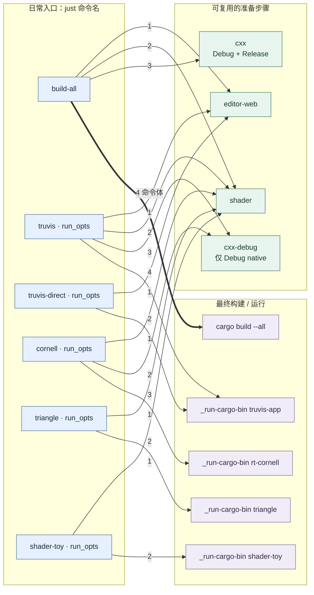
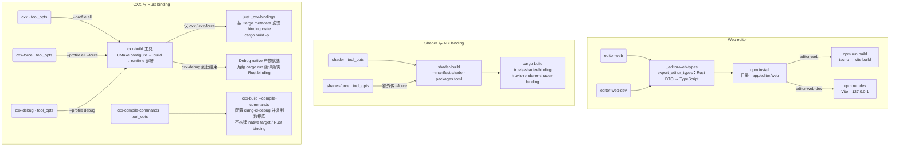
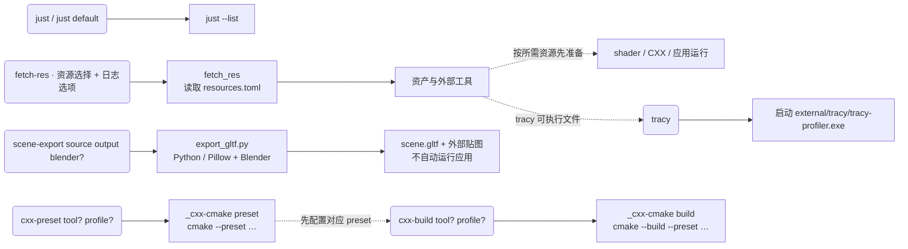
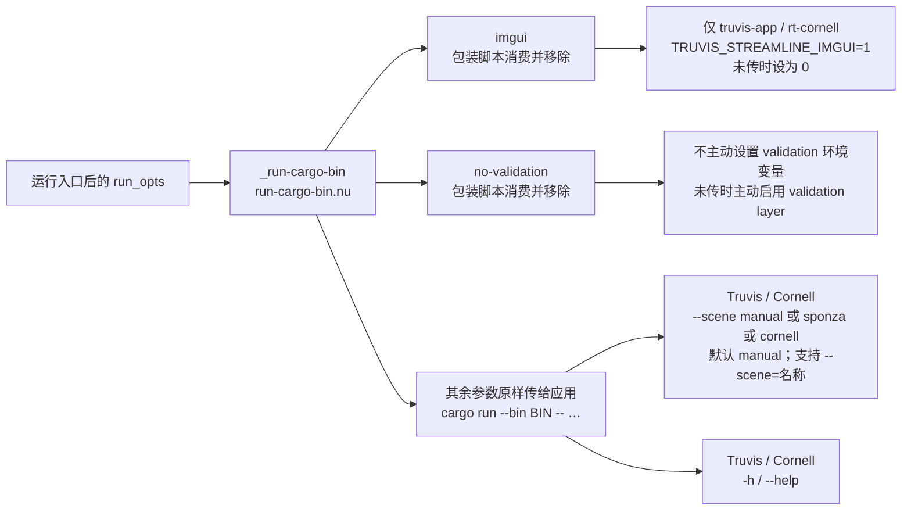

# just 命令图解

按 2026-10-11 的 [justfile](../justfile) 与参数解析实现核对，覆盖 **20 个公开命令、4 个内部 recipe**。这是当前工具流程的使用说明；命令变化时以实现为准。

## 1. 日常入口依赖图

**箭头从调用者指向被调用者**。实线表示 `justfile` 声明的前置依赖，粗线表示命令体内的调用；边上的编号是同一入口的执行顺序，并非并行分支。依赖会先执行完，才进入命令体。



- `truvis-direct` 仍然生成协议类型并构建 Web editor；随后仍是 `cargo run`，可能编译 Rust。使用前需已准备匹配的 shader / native 产物。
- `cornell` 是 standalone 应用入口名，默认场景仍是 `manual`；Cornell Box 要显式传 `--scene cornell`。
- `build-all` 没有参数，不能追加 `--verbose`；运行入口的 `run_opts` 也不会传给前置 shader / CXX 构建。

## 2. 构建命令内部流程

本图箭头统一表示**执行先后**；圆角节点是公开命令，方框是内部 recipe 或实际工具步骤。`shader-force` 和 `cxx-force` 各自直接执行构建工具，不是调用 `shader` / `cxx` recipe。



`cxx` 的 Debug + Release 指 **native 构建与部署**；其 `_cxx-bindings` 使用普通 `cargo build`，未传 `--release`。`cxx-build` 工具的 `--force` 对应 CMake `--clean-first`。

## 3. 资源、手工 CMake 与辅助入口

此图实线表示执行步骤，虚线表示**需要手动满足的前提**，不会自动触发左侧命令。



`fetch-res` 不在 `build-all` 或运行命令的 recipe 依赖中；`tracy` 也不会自动下载工具。手工 `just cxx-build` 不自动调用 `just cxx-preset`，也不执行 Rust 工具的 runtime 部署与 binding 构建。

注意同名区别：**`just cxx-build` 是手工 CMake 入口**；`cargo run --bin cxx-build -- …` 才是 `cxx` 系列使用的自动构建、部署工具。

## 4. 运行选项如何流动



`imgui` 与 `no-validation` 是不带 `--` 的特殊词。`no-validation` 只跳过脚本设置，不会清除父进程已经设置的 validation 环境变量。Triangle / ShaderToy 使用同一包装脚本，但应用本身没有场景或帮助参数解析；`imgui` 对它们没有效果。

## 5. 全部命令与选项速查

下表使用约定：`[x]` 可选，`名称…` 零个或多个参数；`<x>` 是必填值。选项放在 recipe 名后面。这里列的是项目 recipe 接口；`just --help` 查看 just 程序自身的选项。

### 无参数命令与位置参数

| 命令 | 参数、默认值与用途 |
|---|---|
| `just` / `just default` | 无参数，显示公开命令列表 |
| `just build-all` | 无参数，Web → shader → CXX → workspace |
| `just editor-web` | 无参数，协议类型 → npm install → 生产构建 |
| `just editor-web-dev` | 无参数，协议类型 → npm install → 开发服务器；不启动桌面应用 |
| `just tracy` | 无参数，启动已下载的 Tracy Profiler |
| `just scene-export <source> <output> [blender]` | `source`：`.blend` / `.fbx`；`output`：输出目录；`blender` 默认 `C:/Program Files/Blender Foundation/Blender 5.2/blender.exe` |
| `just cxx-preset [tool] [profile]` | `tool`：`vs2026`（默认）/ `vs2022` / `clang`；`profile`：`debug`（默认）/ `release` |
| `just cxx-build [tool] [profile]` | 同上；需要先配置相应 preset |

`scene-export` 的三个参数都是位置参数；不透传额外选项。Python 脚本的 `--texture-size`（默认 2048）、`--texture-root`、`--invert-normal-green` 需要直接调用脚本，不能追加给这个 recipe。手工 CMake 的参数也按位置传，例如 `just cxx-build clang release`，不是 `--tool clang --profile release`。

### 资源选择

| 命令 / 选项 | 含义与限制 |
|---|---|
| `just fetch-res` | 下载默认资源，排除 `download_by_default = false` 的条目 |
| `just fetch-res <名称>…` | 只处理指定资源，可传多个；名称取自 [resources.toml](../resources.toml) |
| `just fetch-res --all` | 处理全部配置资源；不能与资源名称混用 |
| `--verbose` | 可与默认选择、指定名称或 `--all` 配合 |
| `-h` / `--help` | 显示资源工具帮助 |

### Shader 工具选项

以下选项均可传给 `just shader`、`just shader-force`。

| 选项 | 默认 / 行为 |
|---|---|
| `--verbose` | 输出详细日志；默认关闭 |
| `--force` / `-f` | 强制重新编译；`shader-force` 已内置 |
| `--manifest <path>` | recipe 内置 `shader-packages.toml`；追加值会覆盖前值 |
| `-h` / `--help` | 显示工具用法；当前实现以错误结果返回，因此停止 recipe，不再构建 binding |

`shader-force` 仍会执行后续 Rust binding 构建，但不强制清理 Cargo 缓存。

### CXX 工具选项

| Recipe | 内置选项 | 可追加选项 |
|---|---|---|
| `just cxx-debug` | `--profile debug` | `--verbose`、`--force` / `-f`、`--profile <值>`、帮助 |
| `just cxx` | `--profile all` | 同上 |
| `just cxx-force` | `--profile all --force` | 同上；无法用选项关闭已内置的 force |
| `just cxx-compile-commands` | `--compile-commands` | `--verbose`、帮助 |

- `--profile` 的值为 `debug` / `release` / `all`；重复指定时后值覆盖前值，仅改变 native profile。选 `release` 不会让后续 `_cxx-bindings` 自动改成 Release。
- `--compile-commands` 与任何显式 `--profile` 或 `--force` 互斥。因此不能追加给 `cxx` / `cxx-debug` / `cxx-force`，也不能在 `cxx-compile-commands` 后追加 profile 或 force。
- 帮助选项为 `-h` / `--help`；与 shader 工具一样，当前以错误结果返回并停止后续步骤。
- 自动 CXX recipe 没有 `--tool` 选项；手工指定工具链使用 `cxx-preset` / `cxx-build`。

### 运行命令选项

| Recipe | 目标 binary | 有效选项 |
|---|---|---|
| `just triangle` | `triangle` | `no-validation` |
| `just shader-toy` | `shader-toy` | `no-validation` |
| `just cornell` | `rt-cornell` | `imgui`、`no-validation`、`--scene <名称>` / `--scene=<名称>`、`-h` / `--help` |
| `just truvis` | `truvis-app` | 同上 |
| `just truvis-direct` | `truvis-app` | 同上 |

场景名称为 `manual`（默认）、`sponza`、`cornell`。运行 recipe 的 `--help` 也要先走完前置构建；它不是跳过构建的帮助入口。`--release`、`--verbose` 在这里会作为应用参数透传，不会变成 Cargo 或前置构建选项。

## 6. 常用组合

```powershell
# 首次准备与运行：资源下载是显式步骤
just fetch-res
just truvis

# 手工材质场景 / Cornell Box / 带 Streamline 调试界面的 Sponza
just truvis --scene manual
just cornell --scene cornell
just truvis imgui no-validation --scene sponza

# 已准备好 shader / native 产物时，仍构建 Web editor 后启动
just truvis-direct --scene cornell

# 针对性重建并查看详细日志
just shader-force --verbose
just cxx-debug --force --verbose
just cxx-compile-commands --verbose

# 按名称下载 / 下载所有资源
just fetch-res slang tracy --verbose
just fetch-res --all --verbose

# 手工 CMake：先配置，再构建
just cxx-preset clang release
just cxx-build clang release

# 场景转换：带空格的路径用引号包住
just scene-export "D:/assets/scene.blend" "D:/assets/export"

# 只查看展开步骤，不执行构建或启动
just --dry-run truvis imgui --scene cornell
```

## 核对入口

- [justfile](../justfile)：recipe 依赖、顺序、默认参数与固定选项。
- [run-cargo-bin.nu](../scripts/nu/run-cargo-bin.nu)、[cxx-cmake.nu](../scripts/nu/cxx-cmake.nu)、[build-cxx-bindings.nu](../scripts/nu/build-cxx-bindings.nu)：运行选项与 CMake / binding 包装行为。
- [shader-build.rs](../engine/e00-utils/truvis-shader-build/src/bin/shader-build.rs)、[cxx-build/main.rs](../cxx/rust/tools/truvis-cxx-build/src/bin/cxx-build/main.rs)、[fetch_res.rs](../engine/e00-utils/truvis-fetch-res/src/bin/fetch_res.rs)：构建与资源工具选项解析。
- [startup_options.rs](../app/truvis-scenes/src/startup_options.rs)、[export_gltf.py](../scripts/scene/export_gltf.py)：场景参数与导出选项。
