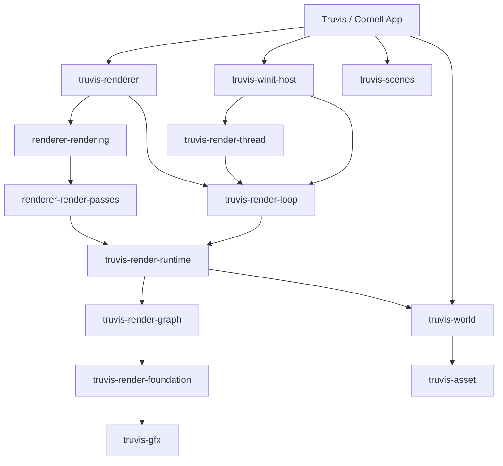

# B00：全局依赖、状态 owner 与扫描覆盖地图

> 历史说明：本文项目 hash、提交次数及“本报告所在提交”均按压缩前历史解释，实验引用保留为“压缩前证据基准”；第三方版本不变。当前分组见[提交压缩映射](commit-squash.md)。

状态：已扫描并完成 master 复核（全局地图范围）。日期：2026-10-28。
压缩前证据基准：`892332a4c47114ff664cde0d815d6875a04228ce`；实现与迁入前 master `9527799b7ca72a25ffa715b6a6ec143f72b7c65d` 相同，两次迁入只改文档。迁入前及复核开始时工作区干净。
原始扫描基准：dlss5 的 `010d963db392fa579aeff18323a5dd7035896f9a`。以下地图和数量已按 master 更新；第 4 节 Shader/native 问题保留原始证据与修复历史，不能把其中 NR 描述视为 master 当前实现。

**结论：当前 workspace 声明的顶层依赖方向成立；sample 启动构建前置缺口仍成立，Shader/native 文档修复适用于 master；本次另确认 Runtime 阶段文档的符号名偏差。尚无充分证据认定模块拆分或公共 trait 整体过度抽象。** 本批建立了全量模块导航及关键 owner 地图，未做逐模块实现审计、完整构建或运行时验收。

后续修复状态：Shader/native P3 已修复并在 master 复核；P2 构建前置缺口已在 [B02-a](B02-a.md) 修改，命令展开顺序已验证，编译与运行边界见其报告；Runtime 文档 P3 已在 [B12-d](B12-d.md) 修正。上段结论保留 B00 基准状态，各问题下分别记录证据基准与行号。

本次重新执行 metadata/内部依赖图、shader include 统计、sample dry-run 和绑定生成链检查；对照两分支差异，重读发生变化的 RenderLoop、Runtime、TruvisRenderer、Gfx 与 DLSS 生命周期入口。App、CPU world/asset、RenderWorld、平台宿主、Client/bridge 和 subsystem trait 的原抽查文件在两基准间无差异，其 owner/线程结论沿用已核对证据，未声称逐行重审这些模块。

master 尚无 NR native/binding/subsystem/pass；`resources.toml:101–129` 的 Remix/NR SDK 配置只代表资源来源。master 的帧循环没有 resource reconfigure hook，也没有帧返回 `Err` 后显式 shutdown 的分支；这些 dlss5 描述已从当前地图移除。

历史重组后，B00 文档与 Shader/native 文档修复合并于`469aeae8`；下文旧 hash 保留为压缩前证据基准，可从本地备份分支 `codex/backup-review-before-squash` 追溯。

## 1. 已检查的范围与证据等级

- 读取根 `AGENTS.md` 与 `.agents/rules/` 三份规则；读取架构入口、分层、线程、Shader/native、Agent integration 设计文档，以及相关顶层/模块 README。
- 使用 `cargo metadata --offline --locked --no-deps --format-version 1` 解析全部 **39 个 crate**（Engine 19、Renderer 10、App 5、CXX 5）；与 `git ls-files '*Cargo.toml'` 的 39 个子 manifest 核对一致。包括普通依赖、build-dependency、targets、features 与 target 条件，不只检查根 workspace 列表。
- 对 workspace 内部的 **155 条直接声明边**（145 normal、10 build）执行方向检查、传递路径检查和拓扑消除；39 个节点全部消除，未发现 workspace 内部环或经 CXX/tool 绕行的顶层反向路径。所有这些 crate 的 package features 均为空，内部依赖声明中无 optional/target 条件；不代表源码没有 `cfg` 或第三方没有 feature 分支。
- 核对唯一 native project 入口、4 个 module 的 CMake target/link 声明、3 个 native binding 的 build script，以及两套 shader binding、路径工具和 Tauri 的 build script，共 7 个 `build.rs`。
- 核对 4 个 shader package、2 个 binding owner；对 98 个 shader 源文件中的 179 条字面量双引号 include 做词法方向/前缀检查，未发现 Engine include Renderer 或缺少 layer/owner 前缀。此检查**不等于**完整 package 闭包、条件预处理、depfile 或 SPIR-V 校验。
- 核对 Web package、Tauri frontendDist、Rust DTO 导出器、just/Nushell 编排与脚本入口；对 Triangle/ShaderToy 执行 `just --dry-run`，只展开命令，没有启动程序。
- 源码按入口与字段抽查：`RenderThread::spawn`、embedded host、`RenderLoop::run/run_frame/shutdown`、Runtime/RenderWorld/RenderAssetSystem/GameWorld 字段与关键阶段、`TruvisRenderer` 字段、`RendererClient`、App wiring/client/desktop、Editor notification task、MCP HTTP thread、asset worker 与 sky worker。

本次 metadata、内部依赖边、include 清单与统计摘要位于 `.temp/code-design/B00-master-*.json`，属于可重建的临时证据，与原 dlss5 输出分开；本报告保留继续审阅所需的结论和入口。未执行 Cargo 编译、native 构建、shader 编译、Web 构建、窗口交互、GPU 或算法验证；第三方依赖闭包未展开。

## 2. 实际依赖与构建方向

### Rust 主干

下面只画主要直接依赖，完整内部声明边可从 metadata 重建。箭头是编译依赖，不是所有权或调用时序。

其他需要记住的真实边：

- `truvis-renderer` 还直接组合 `renderer-kit/imgui/render-ui/render-passes`；`renderer-render-ui -> renderer-rendering + renderer-imgui + renderer-kit`，渲染设置/UI 不由 Runtime 反向依赖。
- `renderer-kit -> render-runtime/render-loop/gfx/render-foundation`。它不是无 Engine 依赖的数学小包：`src/subsystem.rs:21` 的生命周期 trait 和 `:38` 的录制 Ctx 是其明确职责；不能只根据“kit”名称判定依赖多余。
- `truvis-world -> truvis-asset + truvis-shader-binding`。CPU owner 不持有 Vulkan 对象，与完全不依赖 shader 值类型是两回事。是否有不必要的 ABI 语义耦合留给 B09/B03。
- `truvis-gfx -> truvis-streamline-binding + truvis-vk-binding`；`truvis-asset -> truvis-assimp-binding`。Native integration 是横切基础设施，不是第四个产品层；master 尚无 NR binding 接入。
- `truvis-app -> truvis-editor-bridge`。controller 实现在 App 的 RenderThread Client 中，不能沿用历史路径把它归到 Renderer crate。
- App 编译依赖 Renderer 定义的 `RendererClient`，Renderer 持有 `Box<dyn RendererClient>`。运行时回调 App 实现不形成 `renderer -> app` 编译依赖。Truvis/Cornell 是两个已存在的实现，不是为假设用户建立的注入点。
- Engine/Renderer 源码中针对 Tauri、Editor bridge、上层 Renderer crate 名及 `#[path]` 的定向搜索未发现隐藏反向引用；这不是任意宏展开或动态加载行为的形式证明。

### 生成代码和 native 产物

| 链路 | 当前方向 / owner | 后续审阅重点 |
|---|---|---|
| Shader 编译 | `shader-packages.toml -> shader-build -> SPIR-V`；Engine、Renderer、两个 sample 分包 | B02/B03：预检和 depfile 是否同时生效；增量缓存是否包含全部输入 |
| Shader Rust binding | owner Slang ABI → `ffi/rust_ffi.hpp` C++ 解析投影 → bindgen → Rust binding；Renderer binding 依赖 Engine binding | B03：宿主投影/布局/allowlist；native C API 不来自这条生成链 |
| Native C ABI | module public `include/.../c_api/module.h` → CXX bindgen → Rust wrapper；Rust 链接部署后的 DLL/import library | B04：所有权和 unsafe 契约，B02：构建/部署失效 |
| Native 构建 | `just cxx* -> truvis-cxx-build -> CMake -> native 输出/runtime plan -> 部署`；CMake 源码未发现反向调用 Cargo 或依赖 Engine/Renderer shader 目录 | Cargo metadata 看不到这些文件生成前置条件 |
| Web 类型 | `truvis-editor-bridge` 的 Rust DTO → `export_editor_types` → `app/editor/web/src/protocol/generated` → TypeScript/Vite | 工具向 App 写生成物是构建数据流，不是 Renderer 库反向 import App |
| Tauri | Web dist → `tauri.conf.json:7` 的 `frontendDist`；`app/truvis-app/build.rs` 调 `tauri_build::build` | `just truvis/build-all` 提供前置 Web 构建，直接 Cargo 命令不自动补全外部流程 |

`shader-packages.toml` 的显式关系：`renderer -> engine`、`sample-hello-triangle -> engine`；`engine` 与 `sample-shader-toy` 均无 package 依赖。ShaderToy 的 shader 独立不意味着其 Rust 程序绕过通用 Runtime/RHI。

Native 声明含 5 个 library target：`truvixx-utils`、`truvixx-assimp` 为 STATIC；`truvixx-{assimp,vk,streamline}-capi` 为 SHARED。另有 Vulkan bindgen 输入发布用的 custom target。Assimp C API 依赖内部 Assimp 实现；Streamline 依赖 utils；Vulkan bridge 依赖 Vulkan headers。没有把这些 target 当成 Rust 三层镜像。

## 3. 主要状态 owner 与线程地图

表中“owner”是源码字段/调用归属；只说明已检查的静态结构，不承诺所有错误路径均已安全释放。

| 状态或能力 | owner 与执行位置 | 已核对入口 | 下一批 |
|---|---|---|---|
| parent window、桌面关闭、宿主 handle | App `TruvisDesktopState`；desktop resources 在 mutex 下 take，join 在锁外 | `app/truvis-app/src/desktop.rs:60,71,164` | B13/B25 |
| child HWND、winit loop、RenderThread handle | `EmbeddedWinitHost` 及窗口线程 handler；standalone 使用自身窗口主线程 | `engine/e60-platform/truvis-winit-host/src/embedded.rs:67,141` | B13 |
| 渲染 OS thread、退出请求、完成信号 | `RenderThread`；factory 和 RenderLoop 在该线程执行 | `engine/e60-platform/truvis-render-thread/src/render_thread.rs:20,50` | B13 |
| 固定帧骨架、Runtime、具体 Renderer | `RenderLoop` 持有 `Option<RenderRuntime>` 与 `Box<dyn Renderer>` | `engine/e50-render-loop/truvis-render-loop/src/render_loop.rs:19,38,147,271` | B12 |
| Vulkan root、frame/command/binding、present、GameWorld/RenderWorld | `RenderRuntime`；RenderThread | `engine/e40-render/truvis-render-runtime/src/render_runtime.rs:59` | B05/B06/B12 |
| CPU scene 和资源身份 | Runtime-owned `GameWorld` 持有 `SceneStore` 和 `AssetSystem` | `engine/e30-world/truvis-world/src/lib.rs:39` | B08/B09 |
| GPU 资源与派生 scene | `RenderWorld` 持有 `RenderAssetSystem`、instance/light tables、FIF buffers、TLAS、raster cache | Runtime `render_world/render_world.rs:39`、`render_asset_system.rs:30` | B10/B11 |
| camera/input/selection/history 和具体渲染资源 | `TruvisRenderer`；realtime/offline/SDR 等 subsystem 为其字段 | `renderer/truvis-renderer/src/truvis_renderer.rs:37` | B14–B16/B24 |
| 场景初始化、Editor/Automation CPU 操作 | App `TruvisAppClient`，经 `RendererClient` 在 RenderThread 借用 GameWorld | `renderer_client.rs:12`；`app/truvis-app/src/client/mod.rs:62,80` | B21/B22/B25 |
| 请求传输与通知 | 两组独立有界 endpoint；Editor notification dispatcher 是 Tauri async task，不是 scene owner | bridge `src/lib.rs:16,44,53`；App `editor_ipc.rs:23,31` | B21 |
| MCP HTTP listener 与 runtime | App `McpServerHandle` 的独立 `truvis-mcp-http` OS thread；请求等待 oneshot | `app/truvis-app/src/mcp_server.rs:27,37` | B22 |
| CPU 资产读取/解码 | `AssetLoadWorker` 持有 Rayon pool；完成结果回到 GameWorld 同步入口 | `truvis-asset/src/asset_load_worker.rs:50,70`；GameWorld `poll_asset_loads` | B08 |
| CPU sky distribution 构建 | `GpuSkyStore` 中的 builder 持有独立 worker；GPU 上传/发布仍由 RenderThread 做 | Runtime `sky_distribution_builder.rs:71,133`、`gpu_sky_store.rs:385` | B10 |

当前桌面主干不是只有三个线程角色：原三条主线程链之外已增加独立 MCP HTTP 线程，还有 asset pool、sky worker 和 notification task。`threading-and-synchronization.md` 的三线程图只能作为窗口/渲染主链阅读，MCP 的约束需同时读 `agent-integration.md`，后续 B13/B22 核对其完整退出关系。

正常帧主线是 `begin_frame -> input/update -> extent 同步 -> 有效 present target 检查 -> render_frame_input/prepare -> after_prepare -> render -> finish_rendered_frame -> present -> end_frame`。`RenderLoop::run_frame:147` 返回 `()`，Renderer `render` 返回是否提交 scene 的 `bool`；无 present 分支 signal complete 后执行 end_frame。`RenderLoop::run:106–110` 在退出标志触发后显式 shutdown，没有处理帧返回 `Err` 的分支。初始化/普通 panic 与 SDK release 失败的完整退出证明留给 B12/B13/B16。

## 4. 确认问题

### P2：两个 sample 的启动 recipe 未表达 native 构建前置条件（静态确认）

**触发条件**：已准备源码与外部工具，但尚未生成/部署 native 产物，直接使用 `just triangle` 或 `just shader-toy`；native 输入发生变化、只有旧产物时也有同步风险，但其具体表现尚未验证。

证据链：

1. `justfile:83,87` 只声明 `shader` 和 `_run-cargo-bin`；与 `:91,95` 的 Cornell/Truvis 显式依赖 `cxx-debug` 不同。两条 `just --dry-run` 均确认展开中没有 CXX 步骤。
2. `scripts/nu/run-cargo-bin.nu:16` 直接执行 `cargo run`，没有 native 准备。
3. metadata 显示两个 sample 均到达 `truvis-gfx`；`engine/e10-gfx/truvis-gfx/Cargo.toml:11` 无条件依赖 `truvis-vk-binding`。
4. `cxx/rust/bindings/truvis-vk-binding/build.rs:15–17` 必须读取 `build/cxx/generated/include/TruvixxVk/c_api/vulkan_include_roots.txt`；缺失时 `expect` 明确要求先运行 `just cxx-debug`。
5. 该文件由 `cxx/modules/truvixx-vk/CMakeLists.txt:25–30` 的 build custom target 发布。Cargo binding 只消费它，不负责构建 CMake project。

**影响**：公开启动命令的前置构建链不闭合，需要用户隐式了解并先运行 native 准备；这不是 shader 独立性或 Rust 编译依赖图能够弥补的。

**反证与边界**：先运行过 `just truvis` / `just build-all` / `just cxx-debug` 的工作区可以不触发，不能据本机存在 DLL 就撤销问题。本轮没有删除本机产物或进行干净环境构建，故确认的是静态构建缺口，未声称复现失败日志。

**最小建议**：B02/B25 优先让 sample 启动 recipe 显式复用现有 `cxx-debug`；保持 CMake 管 native 构建、Cargo binding 只消费的边界，不增加第二套构建器。当前 `cxx-debug` 准备全部 native module 的成本需一并说明，不借此自动扩展成平台/SDK 可选化重构。

**验证**：先检查 dry-run 中 native 准备先于最终 Cargo；后续在独立、原本没有 native 输出的验证目录运行 sample 构建，确认 header、import library、DLL 和启动。运行成功仍不等于所有渲染能力验收通过。

**B02-a 修复回填（2026-10-28）**：本报告所在的 B02-a sample 提交已为两个 recipe 增加现有 `cxx-debug` 前置，dry-run 确认 native 准备先于最终 Cargo。该 recipe 缺口不再作为当前未修复问题；实际编译结果、干净环境及 GPU 验证缺口见 [B02-a](B02-a.md)。Rust 分层和 shader package 依赖不变，原地图无需重建。

### P3：设计文档混淆 Shader ABI 投影与 native C ABI 源（静态确认）

**原始证据（dlss5 `010d963d`，以下旧行号不用于定位当前文档）**：`docs/design/shader-abi-and-native-integration.md:15` 画出 Engine binding → C ABI/C++ modules；`:41` 写“C++ 只能消费 `ffi/rust_ffi.hpp` 暴露的 C ABI”，`:124` 再以 C++ 是否只消费 public C ABI 作检查项。这与该文 `:59` 的 Rust 消费 native public C ABI、当时 4 个 native `build.rs` 及 module header 方向不一致。

实际 `engine/shader/truvis-shader-binding/ffi/rust_ffi.hpp:4–7` include Slang 基础投影与 ABI；Renderer 的对应 header include Engine/Renderer ABI。它们服务 bindgen 解析 Shader 类型，不是 Assimp/Streamline/NR/Vulkan module 的 public C API 来源。Native binding 读取的是 `cxx/modules/<owner>/include/.../c_api/module.h`。

**影响**：后续维护者可能把生成绑定当成 native 源、误判合法 module 依赖，甚至把两条 owner 不同的生成链重新合并。

**反证**：这不说明当前代码有反向链接；CXX README 和当前构建入口已经表达正确方向。问题限定为活跃设计文档中的图和表述。

**最小建议及验证**：将 Shader ABI → C++ 投影 → Rust binding，与 native public C header → Rust binding 分开描述；不改变 ABI owner、不新增重复类型。用当前 header include、build.rs、CMake target 三方复核。

**压缩前修复记录（2026-10-28）**：已修复并验证（文档与当前源码一致性）。修复已提交为 `080f163703d13810f80d1edd9c3c25bc7e802740`（`[docs] 修正 Shader ABI 与 native C ABI 的生成边界`）；报告及清单随后的审阅流程提交一并保存。原始审阅基准仍为 `010d963db392fa579aeff18323a5dd7035896f9a`。

**压缩前 master 迁入复核（同日）**：上述修复迁入为 `70ec2668`，审阅流程提交 `072f50f8` 迁入为 `892332a4`。本次重新核对两套 Shader header/build.rs、master 的 Assimp/Streamline/Vulkan 三个 native binding 及对应 CMake 声明，修复仍成立；未迁入 NR 或其他 dlss5 实现。下面的四 binding 检查是原分支修复记录。

- 修改设计目标、生成链图、Binding 责任、Native 集成边界与变更检查项，明确 Slang owner 与 CXX module 各自拥有 ABI 源；保留 Renderer 复用 Engine 类型以及 native 不反向链接 Rust 的约束。
- 对照两套 Shader `ffi/rust_ffi.hpp`、对应 `build.rs`，及 Assimp/Streamline/NR/Vulkan 四个 native binding 的 header/link 声明、对应 CMake target；文档方向与这些输入/消费关系一致。
- 文档链接、旧错误表述残留与 diff 格式检查通过。本次未更改 ABI、生成器、构建配置或运行代码，未运行编译、SPIR-V/GPU 验证；不据此宣称 ABI 布局或运行时行为通过验收。
- 影响复核：本报告第 2 节已经正确区分两条生成链，重新核对后保留；第 4 节旧行号仅用于解释修复前问题。B03/B04 后续继续审阅实现，无需重复处理此文档问题。

### P3：Runtime 阶段文档引用过期符号（master 复核新增；静态确认）

**证据与影响**：`docs/design/runtime-phase-contract.md:34,43,54` 仍使用 `sync_dlss_options_frame_state` 和 Renderer `render_view()`；当前实际入口是 `render_runtime.rs:424` 的 `sync_render_extent`、Renderer trait `renderer.rs:78` 的 `render_frame_input`，由 `render_loop.rs:177,204` 调用。按文档定位 API 会找不到对应方法，并误读帧输入边界；这不说明实际阶段顺序存在故障。

**处置**：已在 [B12-d](B12-d.md) 按实际调用链修正同一 design 文档的符号与阶段说明；上段保留 B00 的原始证据，不表示现行文档仍存在该偏差。

## 5. 保留判断与后续候选

| 主题 | 本批判断 | 下一步与入口 |
|---|---|---|
| 三层拆分、独立 RenderLoop/RenderThread/window host | 当前分别承担帧骨架、OS thread 和窗口生命周期，不因转发层多就合并；顶层依赖方向成立 | B12/B13 检查每层是否存在实际冗余状态与失败路径 |
| `RendererClient` / `SubsystemLifecycle` / 窄 Ctx | 当前分别表达 App 注入、静态 subsystem 生命周期和阶段能力，不能凭单实现或薄包装判过度抽象 | B14 逐项核对能力是否真的被限制；B06 检查 public raw API 是否可绕过 |
| CPU、GPU 和 FIF 多份状态 | owner 不同且存在明确派生需求，没有证据支持全局合并 | B09–B11 核对 identity/revision/slot 的同步链 |
| Gfx 默认 Streamline 初始化 | `gfx.rs:224–260` 的生产路径必经 Streamline，失败 panic；虽然有 `new_with_entry_source`，当前 `RenderRuntime::new:95` 调默认入口 | B05/B16/B25 检查 sample 能力成本。README 明确目标为 Windows x64/NVIDIA RTX，当前不作为平台支持缺陷，也不自动建议兼容层 |
| 多级 history/reset | Runtime `history_invalidated`、RenderWorld revision/commit、Truvis view/DLSS/ReSTIR 各有状态；尚不能认定重复 | B11/B12/B14/B16：追踪跳帧、相机切换、submit 失败的传播与消费，不把“都有 bool”当冗余 |
| panic 与显式销毁 | `RenderThread::spawn:53` 的 catch 位于整个 RenderLoop 外；`RenderLoop::run:106–110` 只在正常离开循环后显式 shutdown；不能证明所有 panic 均执行 shutdown | B12/B13：检查 init 部分失败、任意 hook panic、资源 Drop/二次 panic。本批不下泄漏/悬挂的运行时结论 |
| DLSS release 失败 | `truvis-renderer/src/dlss.rs:209–219` 先 take feature 状态，再调用 free，失败只记 warning；与 dlss5 的失败传播不同 | B16 核对 SDK 失败语义、后续资源使用和 root 销毁；目前是候选，未实际触发失败，也未证明存在泄漏 |
| Shader package 独立与 Runtime 能力范围 | shader 的 sample 依赖确实窄；Rust sample 仍经过完整 Runtime/Gfx 路径 | B25 判断是否存在可量化维护/启动代价，再决定是否值得收窄；不要为纯粹图形整齐重构 |

三个核心维度的本批结果：**冗余**未确认可直接删除的模块或实现；**过度抽象**未确认需要全局重划分的证据；**严密性**确认 sample 构建前置关系遗漏。其余候选需模块批次核实，不能把“尚未确认”解释为“全仓没有问题”。

## 6. 非 Rust 覆盖与主负责批次

| 范围 | 主批次 / 关联批次 |
|---|---|
| 根 Cargo/workspace 配置、`.cargo/`、justfile、`scripts/nu/`、CMake presets/helpers/vcpkg、各 build.rs | B02；target/ABI 约束关联 B03/B04 |
| `paths.toml`、`resources.toml`、日志与配置工具 | B01；下载/版本事实关联 B02、B17–B20 |
| `engine/shader/abi`、`renderer/shader/abi`、C++ Shader 投影 header | B03 |
| engine core/scene/lighting shader | B17/B18；scene access 关联 B11；raycast 关联 B24 |
| renderer Realtime/Offline entry 与 shared shader | B15/B17/B18；ReSTIR B19；SHARC/debug B20 |
| raster/post/UI/outline/overlay shader | B15/B16/B24 |
| Hello Triangle / ShaderToy package 与作品集成 | B25；不逐个审计第三方艺术算法 |
| CXX utils、Assimp、VK、Streamline 四个 native module | B04；NVIDIA 生命周期 B16；构建 B02 |
| Web source、TS/Vite/package 配置、生成 DTO 消费方 | B23；协议源 B21 |
| Tauri capabilities/config/build 接入 | B25；IPC B21；MCP B22 |
| `scripts/scene/export_gltf.py`、`validate_gltf.py` | B08 |
| `config/vulkan/` 与启动环境传入 | B02/B05/B25 |
| `.vscode/` 的 shader 搜索路径、CXX 数据库配置 | B02/B03；编辑器个人布局不做代码质量审计 |
| `docs/design/`、模块 README、根 README 与开发命令文档 | 随实际 owner 批次核对；`docs/summary/` 不自动更新 |
| `external/`、`assets/`、生成 bindings/DTO、build 输出 | 第三方/输入/产物；检查适配和生产链，不按第一方源码判重复；`.temp/` 仅为证据 |

下表逐项映射 master 的 39 个 workspace crate；该映射表示已纳入计划，不表示对应模块代码已审计。

| crate | 目录 | 批次 |
|---|---|---|
| cornell-app | `app/samples/cornell-app/` | B25 |
| shader-toy-app | `app/samples/shader-toy-app/` | B25 |
| triangle-app | `app/samples/triangle-app/` | B25 |
| truvis-app | `app/truvis-app/` | B21/B22/B25 |
| truvis-scenes | `app/truvis-scenes/` | B25 |
| truvis-assimp-binding | `cxx/rust/bindings/truvis-assimp-binding/` | B04/B08 |
| truvis-streamline-binding | `cxx/rust/bindings/truvis-streamline-binding/` | B04/B16 |
| truvis-vk-binding | `cxx/rust/bindings/truvis-vk-binding/` | B04/B05 |
| truvis-cxx-binding-codegen | `cxx/rust/tools/truvis-cxx-binding-codegen/` | B02/B04 |
| truvis-cxx-build | `cxx/rust/tools/truvis-cxx-build/` | B02 |
| truvis-logs | `engine/e00-foundation/truvis-logs/` | B01 |
| truvis-utils | `engine/e00-foundation/truvis-utils/` | B01 |
| truvis-fetch-res | `engine/e00-utils/truvis-fetch-res/` | B01 |
| truvis-path | `engine/e00-utils/truvis-path/` | B01 |
| truvis-shader-binding-codegen | `engine/e00-utils/truvis-shader-binding-codegen/` | B02/B03 |
| truvis-shader-build | `engine/e00-utils/truvis-shader-build/` | B02/B03 |
| truvis-shader-manifest | `engine/e00-utils/truvis-shader-manifest/` | B02 |
| truvis-descriptor-layout-macro | `engine/e10-gfx/truvis-descriptor-layout-macro/` | B03 |
| truvis-descriptor-layout-trait | `engine/e10-gfx/truvis-descriptor-layout-trait/` | B03 |
| truvis-gfx | `engine/e10-gfx/truvis-gfx/` | B05 |
| truvis-asset | `engine/e30-world/truvis-asset/` | B08 |
| truvis-world | `engine/e30-world/truvis-world/` | B09 |
| truvis-render-foundation | `engine/e40-render/truvis-render-foundation/` | B06 |
| truvis-render-graph | `engine/e40-render/truvis-render-graph/` | B07 |
| truvis-render-runtime | `engine/e40-render/truvis-render-runtime/` | B06/B10/B11/B12/B24 |
| truvis-render-loop | `engine/e50-render-loop/truvis-render-loop/` | B12 |
| truvis-render-thread | `engine/e60-platform/truvis-render-thread/` | B13 |
| truvis-winit-host | `engine/e60-platform/truvis-winit-host/` | B13 |
| truvis-shader-binding | `engine/shader/truvis-shader-binding/` | B03 |
| truvis-editor-bridge | `renderer/editor/truvis-editor-bridge/` | B21/B22 |
| renderer-imgui | `renderer/renderer-imgui/` | B24 |
| renderer-kit | `renderer/renderer-kit/` | B14/B24 |
| renderer-render-passes | `renderer/renderer-render-passes/` | B15/B16/B24 |
| renderer-render-ui | `renderer/renderer-render-ui/` | B24 |
| renderer-rendering | `renderer/renderer-rendering/` | B15/B16/B19/B20 |
| shader-toy-renderer | `renderer/samples/shader-toy-renderer/` | B25 |
| triangle-renderer | `renderer/samples/triangle-renderer/` | B25 |
| truvis-renderer-shader-binding | `renderer/shader/truvis-renderer-shader-binding/` | B03 |
| truvis-renderer | `renderer/truvis-renderer/` | B14/B16/B24 |

## 7. 修复处置与下一批交接

后续按 [扫描清单](README.md) 的“分批审阅、局部修复、跨模块问题集中处理”执行。下表记录当前处置状态；后续局部修复不扩大 B00 原始审阅或运行验证范围。

| 问题 | 处理状态 | 进入修复的条件 / 目标批次 |
|---|---|---|
| P2：sample 启动 recipe 缺 native 前置 | 已修复并验证 | B02-a 已补前置并验证命令顺序，两个 sample 编译/链接通过；B25 接收干净环境/GPU 验证缺口 |
| P3：Shader/native 文档方向混淆 | 已修复并验证 | 已独立完成文档修复及源码一致性检查；详见第 4 节修复记录，B03/B04 不重复修复 |
| P3：Runtime 阶段文档引用过期符号 | 已局部修复 | B12-d 已核对阶段契约并同步更新，原始发现见第 4 节 |
| 第 5 节 history/reset、panic/退出、SDK owner 候选 | 等待相关批次 | 仍为候选，先由 B11–B16 等对应批次补证据；不能按已确认 bug 直接修改 |

执行修复后在对应发现下补充修改、基准和验证记录；影响本报告的依赖/owner 地图时，对相关结论标记待复核。

- [x] 基准与相关未提交改动已核对。
- [x] Cargo member/依赖、native target、shader package、Web/脚本入口均已归入批次。
- [x] 主要 owner 与线程/阶段地图已按源码入口核对。
- [x] 已分别记录确认问题、保留理由、候选与验证缺口。
- [x] 报告与清单已更新；P3 文档修复、提交及验证已回填，没有修改实现或配置。

**下一批：B01 基础工具与路径。** 从 `truvis-path`、`truvis-utils`、`truvis-logs`、`truvis-fetch-res` 以及 `paths.toml/resources.toml` 开始。先核对 HEAD 和工作区变化，再读取本报告相关地图即可，不需要重读全部 B00 输出。

后续跨批次交接：sample native 前置修改及验证状态见 B02-a，B25 接收其剩余验收；B03/B04 按修正后的文档核对实现，文档方向问题已关闭；B12-d 已处理阶段文档符号偏差，B13/B27 继续接收 panic/退出契约缺口；B14/B16 接收多级 history 与 SDK release/owner 待查项。总体进度以后续更新的 [扫描清单](README.md) 为准。
